# Manual Natty de Pokémon FireRed
*Edição 1.0 · Do primeiro Pokémon até o ginásio da Misty*

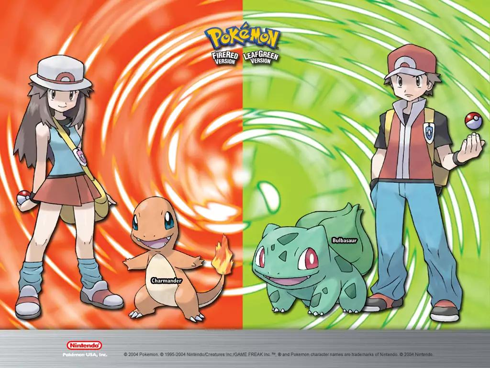

Salve, treinador! Seja bem-vindo a Kanto, a região onde você sai de casa sem dinheiro, sem Pokémon, sem noção de combate e, em aproximadamente vinte minutos, já está espancando animais selvagens para construir uma equipe de elite.

Este manual foi feito para você não precisar descobrir tudo na base da humilhação. Vamos sair de Pallet Town, derrotar Brock, sobreviver à Mt. Moon e chegar ao ginásio da Misty sem transformar o jogo em um emprego de meio período.

*Aviso do Natty:* alguns perrengues são inevitáveis. O importante é sofrer com eficiência.

---

## 1. Pallet Town — O começo da jornada

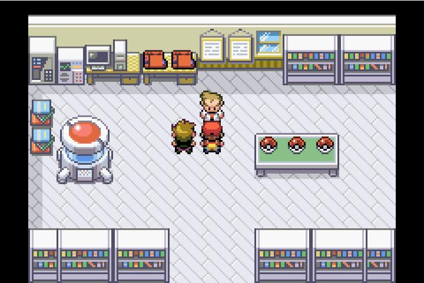

### Escolha seu inicial

Você tem três opções, e cada uma oferece uma experiência diferente:

- **Bulbasaur:** o modo tranquilo. Ajuda bastante contra Brock e Misty.
- **Squirtle:** sólido e confiável. Tem vantagem contra Brock e aprende golpes úteis.
- **Charmander:** o modo sofrimento voluntário. É forte, mas o começo exige mais paciência.

Minha recomendação para um novato? **Bulbasaur.** Você vai encontrar menos obstáculos nos dois primeiros ginásios e poderá aprender as mecânicas sem precisar compensar todas as dificuldades com grind.

Mas, se você escolheu Charmander porque o lagartinho de fogo é irado, mantenha a escolha. Este manual não julga ninguém. Só registra os crimes cometidos contra sua barra de EXP.

### Primeiros passos

- Pegue seu inicial no laboratório do Professor Oak.
- Enfrente seu rival. Se perder, não é o fim do mundo.
- Vá até Viridian City para buscar a encomenda do Oak.
- Volte ao laboratório e receba a Pokédex e as Poké Balls.
- Agora você pode capturar Pokémon. Parabéns: oficialmente, você tem autorização para trabalhar de graça para o Professor Oak.

**Dica Natty:** capture Pokémon que você realmente pretende usar. Não precisa virar colecionador compulsivo logo na primeira rota.

---

## 2. Viridian Forest — O inferno tem seis patas

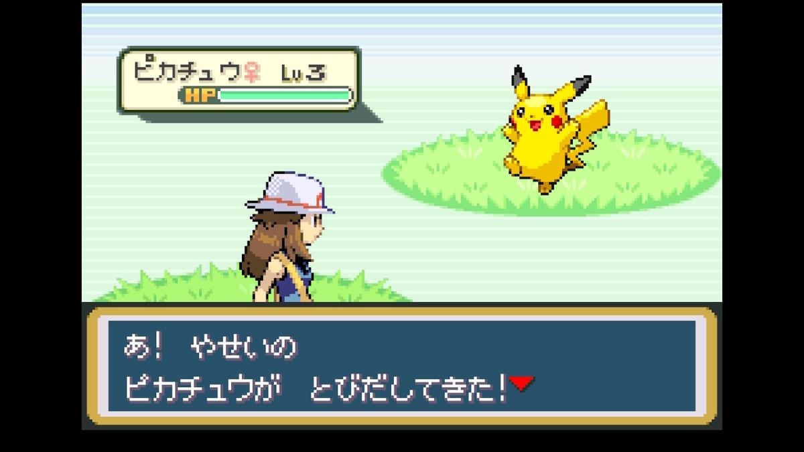

A floresta parece inofensiva até você encontrar um treinador com três Pokémon, perceber que está sem Potion e descobrir que sua equipe inteira está com 12 de HP.

### O que fazer aqui?

- Enfrente os treinadores. Eles dão dinheiro e EXP.
- Capture um Pikachu se quiser um Pokémon elétrico para o futuro.
- Se encontrar Caterpie, considere capturá-lo para evoluir até Butterfree.
- Recolha os itens espalhados pelo chão.
- Evite gastar todas as suas Potions em encontros bobos.

### O fenômeno Butterfree

Butterfree é uma das primeiras oportunidades de ter um Pokémon que usa ataques especiais e aprende golpes úteis relativamente cedo.

Mas existe um detalhe: **ele não é um tanque.**

O bichinho evolui de Caterpie para Metapod e depois Butterfree no nível 10. Você pode ficar animado com a evolução, entrar em uma batalha e descobrir que o seu novo guerreiro alado perde metade da vida para um ataque que parecia inofensivo.

E não, o fato de ele voar não significa que vai desviar de tudo.

- Use Confusion quando estiver disponível para aproveitar o dano especial.
- Aproveite sua vantagem contra Pokémon do tipo Planta e Lutador.
- Tire-o de campo quando aparecer um adversário que possa derrubá-lo rapidamente.
- Não espere que Butterfree resolva todas as batalhas sozinho.

**Regra de ouro:** Pokémon forte não é necessariamente Pokémon resistente.

---

## 3. Pewter City — O primeiro ginásio e o grind da vergonha

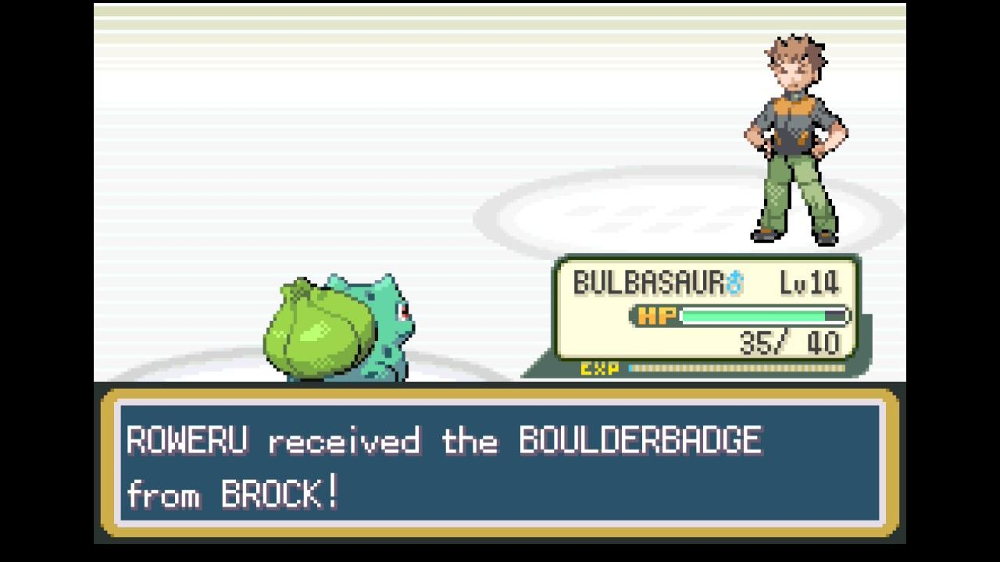

Chegamos ao primeiro chefe de verdade: Brock, o homem que aparentemente decidiu que toda a sua personalidade seria baseada em pedras.

O ginásio usa Pokémon do tipo Pedra, então ataques normais e físicos pouco eficazes podem fazer sua batalha parecer uma sessão de tortura.

### Antes de entrar

Se você escolheu Bulbasaur ou Squirtle, sua vida é relativamente fácil. Se escolheu Charmander, prepare o psicológico.

**Níveis recomendados para chegar confortável:**

- Bulbasaur ou Squirtle: por volta do nível 12–14.
- Charmander: por volta do nível 12–14, mas dê atenção especial aos golpes disponíveis e considere capturar um Pokémon que ajude contra Pedra.

Esses níveis são referências, não exigências. Com uma boa estratégia, dá para vencer antes.

### Como lidar com Brock

- **Bulbasaur:** use Vine Whip, quando disponível. É a solução mais direta.
- **Squirtle:** Water Gun resolve muito bem.
- **Charmander:** não espere que Ember seja uma resposta milagrosa contra Pokémon de Pedra. Considere capturar um Mankey na Route 22, a oeste de Viridian City, ou treinar um Pokémon com golpes eficazes.

Uma observação importante: Charmander não precisa evoluir para vencer Brock, mas evoluir para Charmeleon no nível 16 também não vai acontecer a tempo se você estiver seguindo uma progressão normal.

### O grind antes de Brock

Aqui começa o clássico ritual de FireRed: andar pela grama, derrotar Pokémon selvagens, voltar ao Centro Pokémon e repetir tudo até o nível subir.

É tedioso? Sim.

É necessário? Depende do seu inicial, dos golpes e de como você está jogando.

O erro é ficar lutando contra Pokémon que dão pouca EXP durante meia hora sem perceber que os treinadores da rota oferecem batalhas melhores.

**Dica Natty:** enfrente os treinadores disponíveis antes de insistir no grind selvagem. E não tenha vergonha de voltar ao Centro Pokémon. A enfermeira Joy não está decepcionada com você.

### Recompensa

Ao vencer Brock, você recebe a Boulder Badge e o TM39, Rock Tomb.

Primeiro ginásio concluído. Você já está oficialmente menos indefeso do que estava quando saiu de casa.

---

## 4. Route 3 — A estrada da EXP e das decisões questionáveis

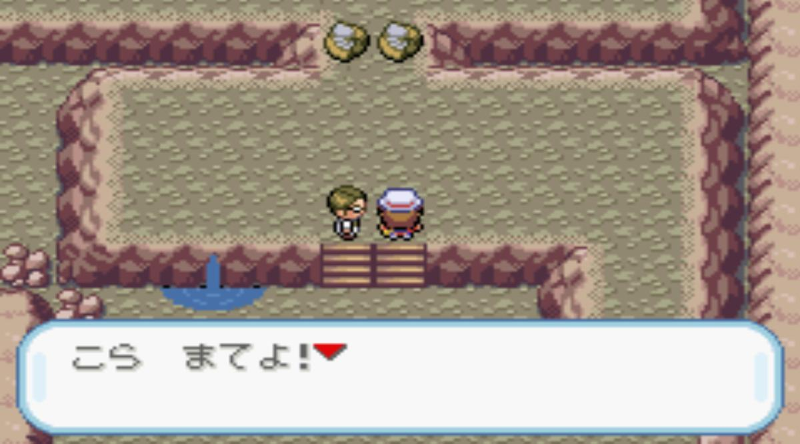

A Route 3 tem uma sequência de treinadores. É uma excelente oportunidade para fortalecer a equipe antes da Mt. Moon.

### Seu checklist

- Enfrente os treinadores que encontrar.
- Observe quais Pokémon estão ficando para trás em nível.
- Cure sua equipe quando necessário.
- Compre algumas Potions e Poké Balls antes de avançar.
- Capture um Pokémon novo somente se ele tiver uma função útil na equipe.

### Quem vale a pena considerar?

- **Mankey:** boa opção para quem precisa de ajuda contra Brock ou quer um atacante do tipo Lutador.
- **Nidoran♂ ou Nidoran♀:** opções versáteis, com potencial para aprender diferentes golpes.
- **Pikachu:** pode ser útil contra Misty, embora capturá-lo na Viridian Forest seja uma questão de sorte.

Não precisa capturar todos. Uma equipe de seis Pokémon subtreinados pode dar mais trabalho do que uma equipe de três bem preparados.

---

## 5. Mt. Moon — A caverna dos Zubats e da sua sanidade

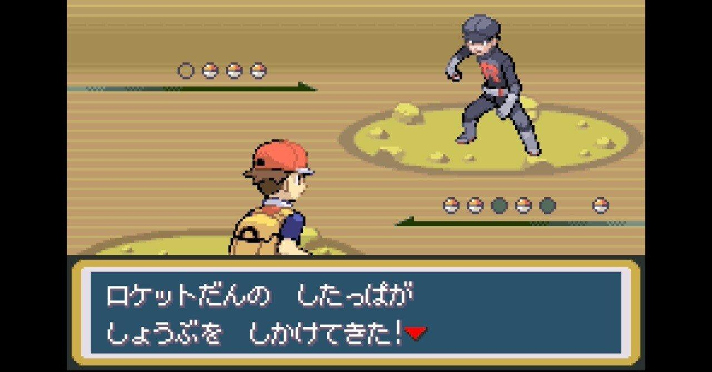

A Mt. Moon é onde FireRed começa a testar sua paciência de verdade.

Você entra para atravessar uma caverna e sai com a impressão de que todos os Zubats de Kanto organizaram uma reunião extraordinária para impedir sua passagem.

### O que esperar

- Encontros frequentes com Pokémon selvagens.
- Geodudes que podem ser irritantes se sua equipe não tiver golpes eficazes.
- Treinadores espalhados pela caverna.
- Integrantes da Equipe Rocket tentando atrapalhar sua vida.
- Itens escondidos ou espalhados pelo caminho.

### Como sobreviver

- Leve Antidotes se estiver preocupado com envenenamento.
- Compre Potions antes de entrar.
- Use o mapa ou explore cada bifurcação com calma.
- Não gaste todos os seus PP em batalhas que você poderia evitar.
- Aproveite a EXP dos treinadores, mas não prolongue a exploração só para derrotar mais um Zubat.

**Perrengue real:** às vezes, você está com pouca vida, sem PP para o golpe principal e aparece mais um Pokémon selvagem. É nessa hora que você aprende que fugir também é uma mecânica de combate.

### A escolha do fóssil

No final da caverna, você terá que escolher entre dois fósseis:

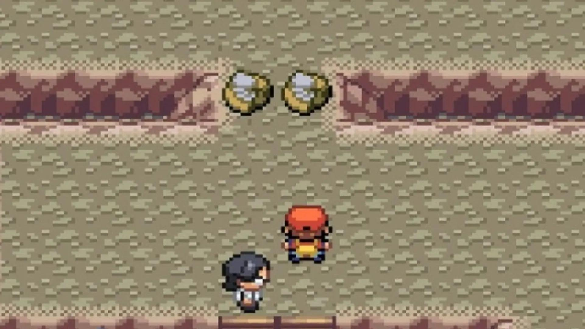

- **Dome Fossil — Kabuto:** escolha se quiser Kabuto, que poderá evoluir para Kabutops.

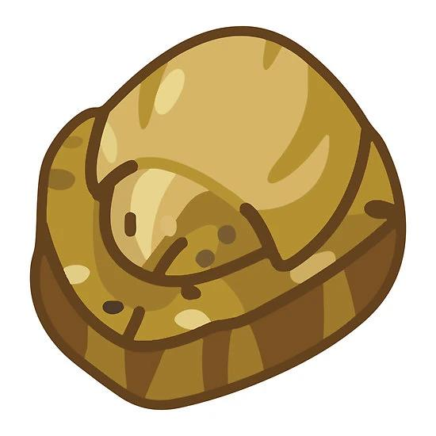

- **Helix Fossil — Omanyte:** escolha se quiser Omanyte, que poderá evoluir para Omastar.

Você não poderá pegar os dois nessa mesma jogada normal. Escolha o que preferir — ou faça a escolha cientificamente comprovada por absolutamente nenhum critério: qual fóssil tem a aparência mais legal.

Os fósseis poderão ser revividos mais adiante, em Cinnabar Island.

---

## 6. Cerulean City — A calma antes da Misty

Você saiu da Mt. Moon, atravessou um túnel cheio de morcegos e finalmente chegou a Cerulean City.

Agora é hora de respirar. E, principalmente, de organizar sua equipe.

### Antes do ginásio

- Cure todos os Pokémon.
- Verifique se seus golpes estão adequados.
- Enfrente os treinadores disponíveis nas rotas próximas.
- Explore a cidade e confira os itens acessíveis.
- Prepare-se para enfrentar seu rival novamente na região da Nugget Bridge.

### O rival está de volta

Na Route 24, ao norte da cidade, seu rival aparece para mais uma batalha.

Não subestime o combate só porque já o venceu no começo. A equipe dele cresce junto com o jogo, e Pokémon com vantagem de tipo podem transformar uma luta simples em um problema.

**Dica Natty:** não entre nessa batalha com metade da equipe desmaiada só porque você acabou de sair do Centro Pokémon e quer economizar tempo. Essa economia pode custar uma derrota.

### Nugget Bridge

Depois do rival, você encontrará vários treinadores em sequência. Vença-os para ganhar dinheiro, EXP e um Nugget ao completar o desafio.

Não venda sua dignidade para comprar cinco Poké Balls extras. Venda o Nugget. Ele existe literalmente para isso.

---

## 7. O ginásio da Misty — Hora de aprender o respeito pela água

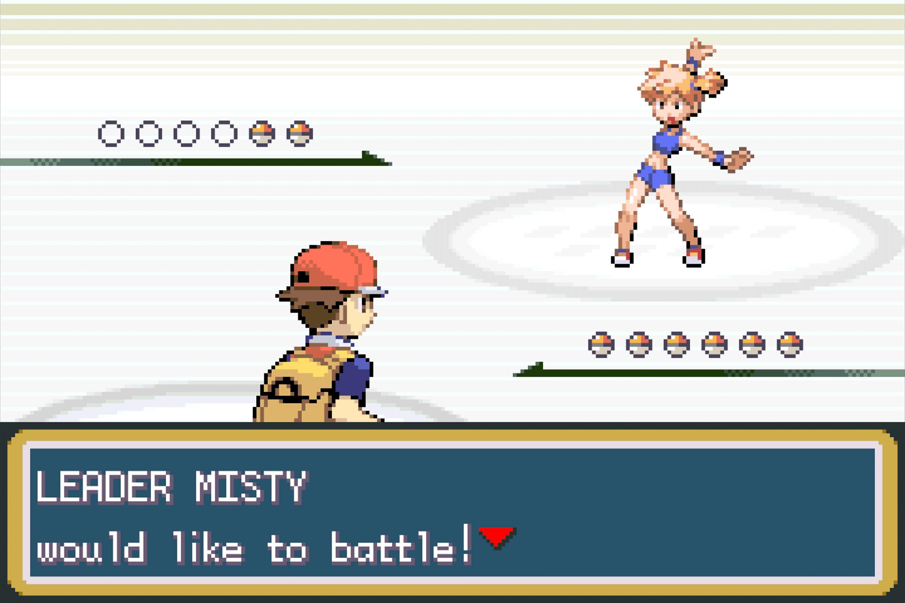

Misty é a segunda líder de ginásio e usa Pokémon do tipo Água. A luta pode ser fácil ou um verdadeiro banho de humildade, dependendo da sua equipe.

Seu principal problema é Starmie: rápido, forte e capaz de punir treinadores que chegam ao ginásio sem planejamento.

### A equipe da Misty

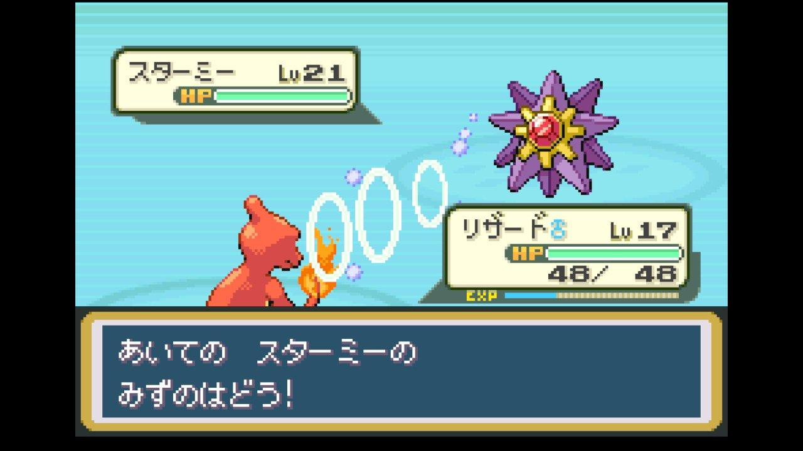

No FireRed original, Misty usa:

| Pokémon | Nível | Tipo |
|---|---:|---|
| Staryu | 18 | Água |
| Starmie | 21 | Água/Psíquico |

Starmie é o grande perigo. Não é só uma estrela do mar simpática: ela tem bons atributos e pode causar bastante dano.

### Como vencer com cada inicial

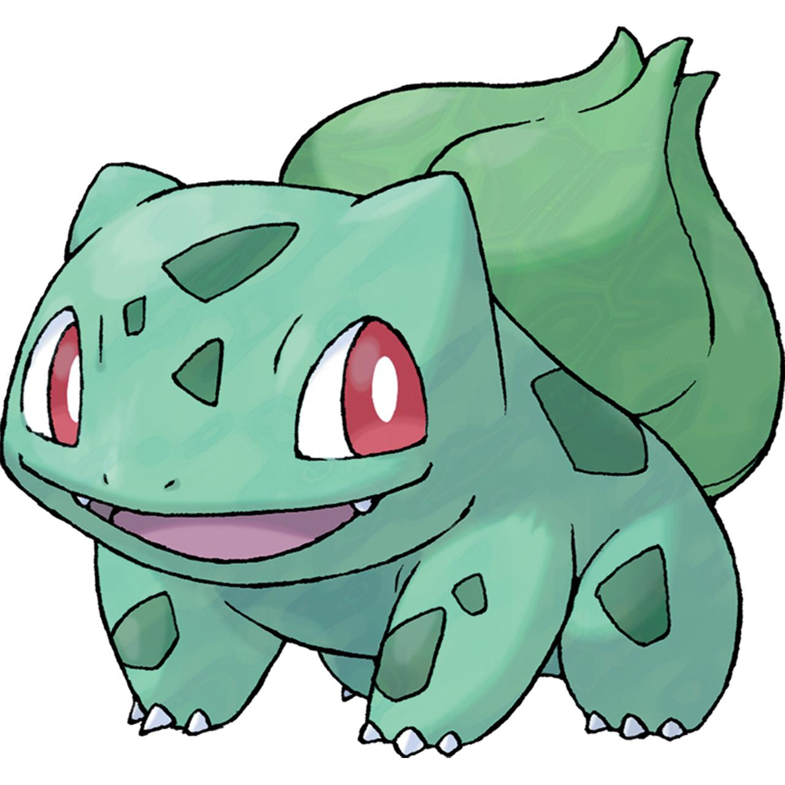

**Se você escolheu Bulbasaur**

Você tem uma vantagem enorme. Golpes do tipo Planta são super eficazes contra Água. Use-os e evite desperdiçar turnos com ataques fracos. Se Bulbasaur já tiver evoluído para Ivysaur, melhor ainda.

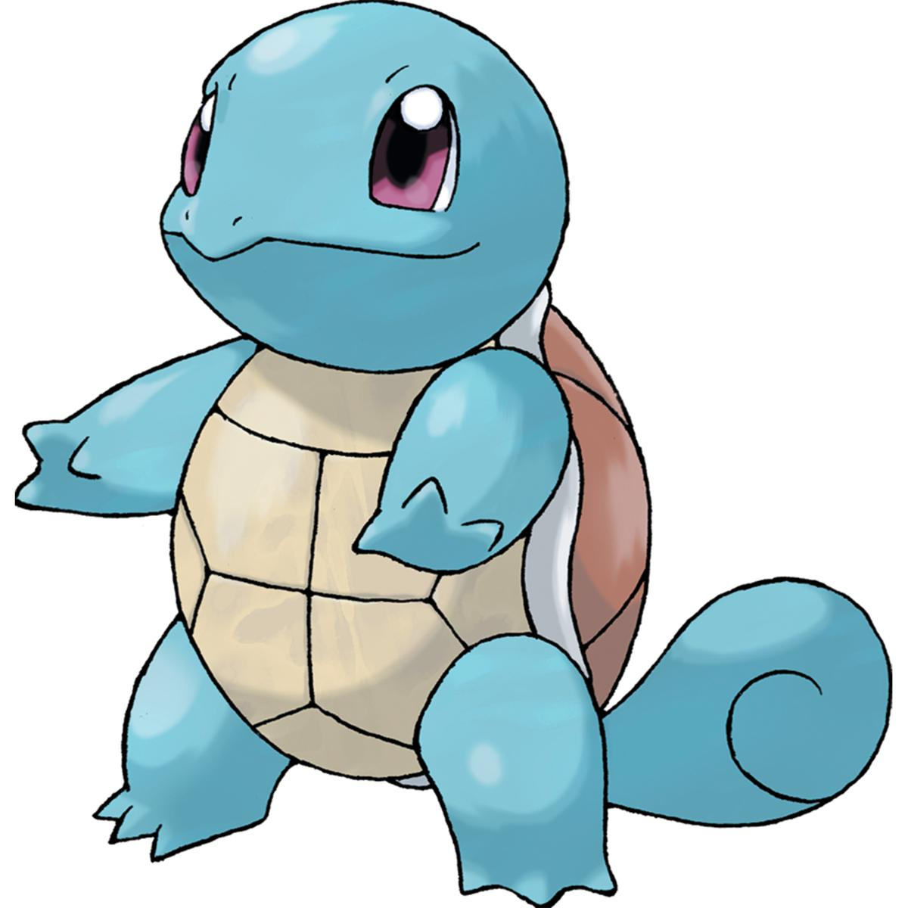

**Se você escolheu Squirtle**

Aqui o jogo deixa de ser tão confortável. Água resiste a Água, então a luta pode virar uma disputa de resistência. Considere usar um Pokémon elétrico ou de Planta, se tiver um bem treinado.

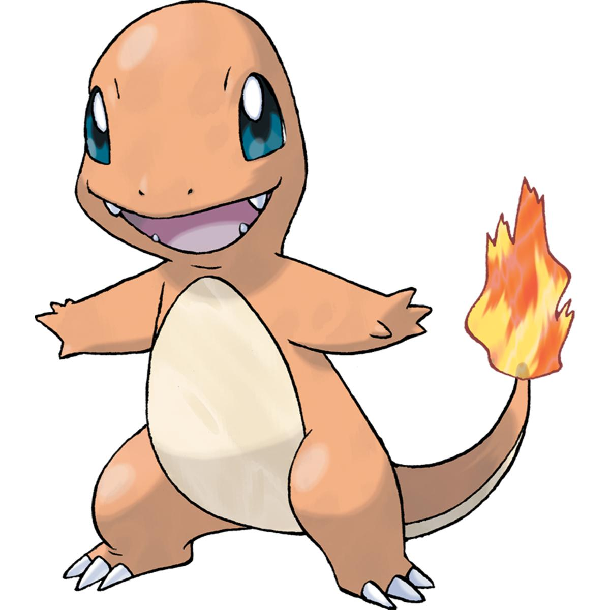

**Se você escolheu Charmander**

Bem-vindo à consequência das suas escolhas. Fogo não tem vantagem contra Água, e Starmie pode castigar sua equipe. Um Pikachu ou outro Pokémon com golpes elétricos é uma boa alternativa. Um Pokémon de Planta também ajuda muito.

### E o Butterfree?

Se você capturou um Caterpie na floresta e o evoluiu, Butterfree pode contribuir com Confusion e outros golpes de suporte. Mas não confunda utilidade com invencibilidade.

Starmie é rápido, e Butterfree não é particularmente resistente. Se o adversário começar a causar muito dano, troque de Pokémon. Não precisa sacrificar seu inseto favorito para provar um ponto.

### Preparação recomendada

- Chegue com a equipe por volta dos níveis 18–21, dependendo dos Pokémon e golpes.
- Leve algumas Potions.
- Tenha pelo menos uma opção de ataque super eficaz, se possível.
- Não confie exclusivamente no seu inicial.
- Se perder, analise o que aconteceu antes de voltar correndo para a revanche.

A ideia não é vencer todas as batalhas de primeira. É parar de repetir o mesmo erro esperando um resultado diferente.

---

## 8. Checklist final do Natty

- [ ] Escolhi meu inicial e recebi a Pokédex.
- [ ] Atravessei a Viridian Forest e enfrentei os treinadores.
- [ ] Derrotei Brock e recebi a Boulder Badge.
- [ ] Treinei na Route 3 e comprei itens de cura.
- [ ] Atravessei a Mt. Moon e escolhi um fóssil.
- [ ] Venci meu rival e os treinadores da Nugget Bridge.
- [ ] Preparei uma estratégia para Starmie.
- [ ] Derrotei Misty e consegui a Cascade Badge.

---

## 9. As cinco leis sagradas de FireRed

1. **Não subestime a vantagem de tipo.** Um Pokémon alguns níveis mais fraco pode vencer se tiver o golpe certo.
2. **Não treine seis Pokémon ao mesmo tempo sem necessidade.** Dividir a EXP demais pode deixar sua equipe inteira fraca.
3. **Não ignore os treinadores.** Eles ajudam a subir de nível e rendem dinheiro para itens.
4. **Não transforme toda derrota em uma sessão de grind.** Às vezes, você só precisa mudar a estratégia.
5. **Não confie cegamente no Butterfree.** Ele pode carregar batalhas, mas também pode virar uma borboleta caída no primeiro ataque mais forte.

E, acima de tudo, lembre-se: Pokémon FireRed é uma aventura. Se você quiser passar vinte minutos tentando capturar um Pikachu porque decidiu que ele será seu parceiro até a Liga Pokémon, vá em frente.

O importante é chegar ao fim da jornada com uma equipe que você gosta — e histórias suficientes para dizer que Kanto não foi moleza.

**Próximo objetivo:** depois de derrotar Misty, você terá a Cascade Badge e poderá avançar pela Route 25, explorar a área de Bill e continuar sua aventura rumo a Vermilion City.

Agora salve o jogo, compre algumas Potions e vá mostrar para aquela estrela-do-mar quem manda em Cerulean.